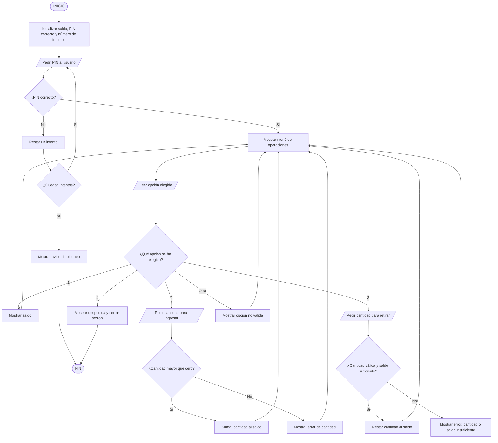

# PARTE 1 — Diseño del cajero automático

## Diagrama de flujo con símbolos



## Leyenda

- **Óvalo/terminal:** inicio o final (`([INICIO])`).
- **Rectángulo:** acción o proceso (`[Mostrar saldo]`).
- **Paralelogramo:** entrada o salida (`[/Pedir PIN/]`).
- **Rombo:** condición que tiene salidas como sí/no (`{¿PIN correcto?}`).
- **Flechas:** indican el orden y las repeticiones del proceso.

## Métodos, parámetros y valores devueltos

| Método | Parámetros de entrada | Devuelve | Descripción |
|---|---|---|---|
| `pedirPin()` | Ninguno | `String`: PIN escrito | Solicita el PIN al usuario. |
| `validarPin(String pinIntroducido, String pinCorrecto)` | PIN introducido y PIN correcto | `boolean` | Comprueba si los PIN coinciden. |
| `mostrarMenu()` | Ninguno | `int`: opción | Enseña las operaciones y devuelve la opción elegida. |
| `mostrarSaldo(double saldoActual)` | Saldo actual | `void` | Muestra el saldo. |
| `pedirCantidad()` | Ninguno | `double`: cantidad | Pide el importe al usuario. |
| `validarCantidad(double cantidad)` | Cantidad introducida | `boolean` | Comprueba que la cantidad sea mayor que cero. |
| `ingresarDinero(double saldoActual, double cantidad)` | Saldo y cantidad | `double`: saldo nuevo | Suma una cantidad válida al saldo. |
| `retirarDinero(double saldoActual, double cantidad)` | Saldo y cantidad | `double`: saldo nuevo | Resta el importe si es positivo y hay saldo suficiente. |
| `mostrarMensaje(String mensaje)` | Mensaje | `void` | Muestra confirmaciones o errores. |
| `registrarOperacion(String tipo, double cantidad, double saldoFinal)` | Tipo, importe y saldo final | `void` | Método auxiliar opcional para registrar operaciones. |
| `cerrarSesion()` | Ninguno | `void` | Muestra la despedida y termina la sesión. |

## Pseudocódigo

```text
INICIO
    saldo <- 500.00
    pinCorrecto <- "1234"
    intentosRestantes <- 3
    accesoConcedido <- FALSO

    MIENTRAS intentosRestantes > 0 Y accesoConcedido = FALSO HACER
        pinIntroducido <- pedirPin()
        SI validarPin(pinIntroducido, pinCorrecto) ENTONCES
            accesoConcedido <- VERDADERO
        SI NO
            intentosRestantes <- intentosRestantes - 1
            mostrarMensaje("PIN incorrecto")
        FIN SI
    FIN MIENTRAS

    SI accesoConcedido = VERDADERO ENTONCES
        opcion <- 0
        MIENTRAS opcion <> 4 HACER
            opcion <- mostrarMenu()
            SEGÚN opcion HACER
                CASO 1:
                    mostrarSaldo(saldo)
                CASO 2:
                    cantidad <- pedirCantidad()
                    SI validarCantidad(cantidad) ENTONCES
                        saldo <- ingresarDinero(saldo, cantidad)
                    SI NO
                        mostrarMensaje("La cantidad debe ser mayor que cero")
                    FIN SI
                CASO 3:
                    cantidad <- pedirCantidad()
                    SI validarCantidad(cantidad) Y cantidad <= saldo ENTONCES
                        saldo <- retirarDinero(saldo, cantidad)
                    SI NO
                        mostrarMensaje("Cantidad no válida o saldo insuficiente")
                    FIN SI
                CASO 4:
                    cerrarSesion()
                OTRO CASO:
                    mostrarMensaje("Opción no válida")
            FIN SEGÚN
        FIN MIENTRAS
    SI NO
        mostrarMensaje("Cajero bloqueado por superar los intentos")
    FIN SI
FIN
```
